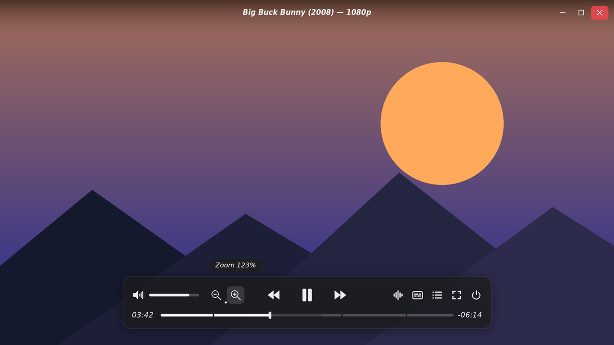
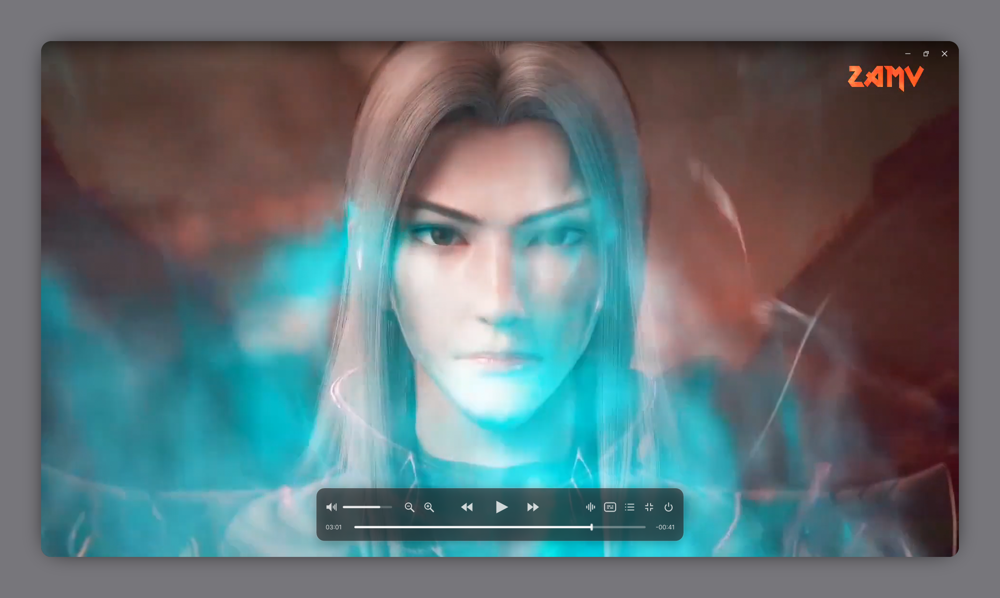
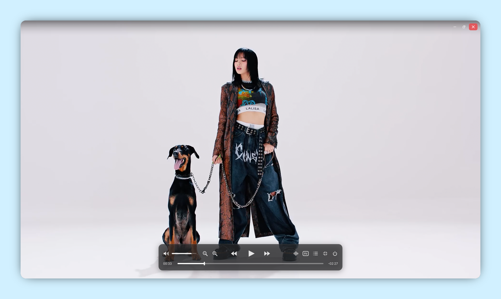

# mpv IINA-style for Linux - Modern GUI 

<table>
  <tr>
    <td align="center" width="10%">
      
    </td>
</table>


<table>
  <tr>
    <td align="center" width="33%">
      
    </td>
    <td align="center" width="33%">
      
    </td>
    <td align="center" width="33%">
      
    </td>
  </tr>
</table>


> The image above is a **design preview** drawn with the same geometry as the script. Inside mpv it will look slightly different (libass font rendering).

## What's in the package

```
mpv-iina-linux/
├── install.sh                 ← installer (works offline)
├── mpv.conf                   ← main mpv settings
├── input.conf                 ← keyboard shortcuts
├── scripts/
│   └── iina_osc.lua           ← the interface itself (~1100 lines of Lua)
├── script-opts/
│   ├── iina_osc.conf          ← appearance / behaviour options
│   └── uosc.conf              ← only used if you install uosc ("menus only" mode)
└── vendor/                    ← bundled thumbfast + uosc 5.13.0 (offline install)
```

### Features of `iina_osc.lua`
- Floating, rounded, translucent panel at the bottom centre with a soft shadow and hairline border, like IINA
- **Centre:** 10-second rewind / play-pause / 10-second forward
- **Left:** volume icon + slider, then 🔍− zoom out / 🔍+ zoom in
- **Right:** audio track, subtitles, playlist, fullscreen, ⏻ quit
- Tooltips on every button
- Thin seekbar with a vertical knob, chapter marks, buffered ranges and a time/chapter preview on hover
- Click the time on the right to switch between remaining time and total duration
- Top title bar with a gradient, plus minimal **− □ ×** window buttons (minimize / maximize / close) in the top-right corner. They fade in and out together with the panel, and they also show on the idle screen and in fullscreen, where □ exits fullscreen.
- Idle screen with an "open file" button
- Seek thumbnails (when thumbfast is installed)
- Menus via uosc, or mpv's built-in menus (mpv 0.39+) when uosc isn't installed
- Auto-hide with fade, correct scaling on HiDPI and Wayland

## 1. Requirements

```bash
# Debian / Ubuntu
sudo apt install mpv fonts-inter fonts-vazirmatn zenity
# Arch
sudo pacman -S mpv inter-font vazirmatn-fonts zenity
# Fedora
sudo dnf install mpv rsms-inter-fonts zenity
```

mpv must be **0.37 or newer** (the script uses the `mouse-pos` property):

```bash
mpv --version | head -1
```

If your distribution ships an older mpv, use the Flatpak (`io.mpv.Mpv`) or a PPA.

## 2. Install

```bash
unzip mpv-iina-linux.zip
cd mpv-iina-linux
chmod +x install.sh

./install.sh                # interface only
./install.sh --thumbnails   # + seek thumbnails (thumbfast)
./install.sh --uosc         # + uosc menus and file browser
./install.sh --all          # everything
```

The installer works **offline**: thumbfast and uosc come from the `vendor/` folder.
To download the latest versions from GitHub instead, add `--online`. Behind a proxy or VPN, also add `--proxy`:

```bash
./install.sh --all --online --proxy socks5h://127.0.0.1:10808
```

What the installer does:
1. Backs up `~/.config/mpv` to `~/.config/mpv.backup-<date>`.
2. Moves other OSC scripts (`modernz.lua`, `modernx.lua`, …) to `scripts-disabled/`, so you don't get two bars on top of each other.
3. Copies the files into place.

Run it:

```bash
mpv                         # idle screen
mpv ~/Videos/film.mkv
```

### Flatpak
The Flatpak config folder is in a different place:

```bash
MPV_HOME=~/.var/app/io.mpv.Mpv/config/mpv ./install.sh --all
```

## 3. Manual install

| File | Destination |
|---|---|
| `scripts/iina_osc.lua` | `~/.config/mpv/scripts/` |
| `script-opts/iina_osc.conf` | `~/.config/mpv/script-opts/` |
| `mpv.conf`, `input.conf` | `~/.config/mpv/` |
| `vendor/scripts/thumbfast.lua` (optional) | `~/.config/mpv/scripts/` |
| `vendor/uosc/scripts/uosc/` + `vendor/uosc/fonts/*` + `script-opts/uosc.conf` (optional) | `~/.config/mpv/scripts/`, `~/.config/mpv/fonts/`, `~/.config/mpv/script-opts/` |

Two lines in `mpv.conf` are required:

```ini
osc=no        # otherwise mpv's old OSC is drawn as well
osd-bar=no
```

## 4. Customising (`script-opts/iina_osc.conf`)

| Option | Default | Description |
|---|---|---|
| `panel_width` | `640` | Panel width |
| `panel_radius` | `14` | Corner radius |
| `panel_color` | `#1E1E20` | Panel colour |
| `panel_opacity` | `0.72` | Lower = more transparent |
| `accent_color` | `#FFFFFF` | Seekbar progress colour, e.g. `#0A84FF` (Apple blue) |
| `scale` / `scale_fullscreen` | `1.0` / `1.2` | UI scale |
| `hide_timeout` | `2000` | Milliseconds before hiding |
| `keep_on_pause` | `no` | Stay visible while paused |
| `title_bar` | `auto` | `yes` = always show the title bar |
| `window_buttons` | `yes` | − □ × buttons: `yes` = always, `windowed` = not in fullscreen, `auto` = only with `border=no`, `no` = off |
| `jump_seconds` | `10` | Rewind / forward amount |
| `quit_button` | `yes` | ⏻ quit button on the panel |
| `zoom_buttons` | `yes` | Zoom in / out buttons |
| `zoom_step` | `0.1` | Size of each zoom step (`0.25` ≈ 19 %) |
| `zoom_min` / `zoom_max` | `-2` / `3` | Zoom range (25 % – 800 %) |
| `menu_backend` | `auto` | `uosc` or `select` |
| `thumbnails` | `yes` | Seek thumbnails via thumbfast |

Restart mpv after editing this file.

**Light theme** (like IINA's light mode):

```ini
panel_color=#F2F2F7
foreground_color=#1C1C1E
accent_color=#0A84FF
border_color=#000000
```

## 5. Controls

| Action | Mouse | Keyboard |
|---|---|---|
| Play / pause | centre button | `Space` |
| Back / forward 10 s | ⏪ ⏩ (right click = 60 s) | `←` `→` = 5 s |
| Seek | click or drag the seekbar, or scroll over it | `Shift+←` `Shift+→` |
| Volume | drag the slider or scroll over the panel | `↑` `↓` |
| Mute | speaker icon | `m` |
| Subtitles | subtitle button (right click = show / hide) | `s` / `v` |
| Audio track | waveform button | `a` |
| Playlist / chapters | list button / right click on it | `n` / `N` |
| Speed | click the "1.5×" pill = normal speed | `[` `]` `Backspace` |
| Fullscreen | button or double-click on the video | `f` |
| Zoom in | 🔍+ (or scroll over the zoom buttons) | `Ctrl+=` or `Ctrl+Wheel up` |
| Zoom out | 🔍− | `Ctrl+-` or `Ctrl+Wheel down` |
| Zoom 100 % | right click on a zoom button | `Ctrl+0` |
| Pan the zoomed video | — | `Alt+arrows` |
| Minimize / maximize / close window | − □ × in the top-right corner | — |
| Quit | ⏻ (right click = quit and remember position) | `q` / `Q` |
| Open file | button on the idle screen | `o` |
| Pin the controls | — | `Tab` |
| Main menu (with uosc) | right click | — |

## 6. How it works (for editing the code)

- **Drawing:** everything is drawn with ASS vector shapes (`\p1`) on a single `ass-events` overlay. The overlay is the same size as `osd-dimensions`, so 1 unit = 1 screen pixel.
- **Icons:** each icon in the `icons` table is a function that draws around its centre `(x, y)` with size `s`. To change an icon, edit that function.
- **Layout:**
  - `draw_panel` builds the top row (buttons) and the bottom row (seekbar).
  - `draw_topbar` builds the title bar and the − □ × window buttons.
  - `draw_idle` builds the idle screen.
- **Clicks:** every button registers a hit-box with `add_element`. Clicks are captured through an input section with a mouse area that only covers the panel and the window buttons. That way, window dragging and double-click to fullscreen keep working everywhere else.
- **Show / hide:** mouse movement calls `show()`. A timer fades everything out after `hide_timeout`, unless the cursor is over the panel or the window buttons.

Example: adding a screenshot button inside `draw_panel` (add it to the `right` list):

```lua
right[#right + 1] = { id = "shot", icon = function(x, op) icons.audio(x, cy, 17 * sc, op) end, props = {
    click = function() mp.commandv("screenshot") end,
    tip   = "Screenshot",
} }
```

## 7. Troubleshooting

**mpv's old OSC is also visible** → check that `osc=no` is in `mpv.conf`.

**No panel appears** → run mpv from a terminal and look for `iina_osc` errors:
```bash
mpv --msg-level=iina_osc=debug ~/Videos/film.mkv
```
An error about `mouse-pos` means your mpv is too old (0.37+ is required).

**Two bars on top of each other** → make sure no other OSC (`modernz.lua`, `modernx.lua`, …) is in `~/.config/mpv/scripts/`. If uosc is installed, you need this package's `script-opts/uosc.conf`.

**The − □ × buttons don't show** → move the mouse over the video (they appear together with the panel) and check `window_buttons=yes` in `iina_osc.conf`. Run `mpv -v file.mkv 2>&1 | grep iina_osc` to see why they're hidden: the log prints `window_buttons=… border=… -> buttons shown/hidden`.

**Minimize does nothing on Wayland** → this depends on the compositor. mpv can only *request* minimizing.

**"Open file" button does nothing** → install `zenity` or `kdialog`, or install with `--uosc`.

**Panel too small / too large (HiDPI)** → change `scale=` in `iina_osc.conf`.

**`curl: (35) TLS connect error … unexpected eof`** → the connection to GitHub is being cut off. Install without `--online` to use the bundled files in `vendor/`, or download through `--proxy`.

**"Font 'Inter' not found" although it's installed** → fixed. The old check (`fc-list | grep -q`) failed under `set -o pipefail`; the installer now uses `fc-match`.

**Restore your previous config**
```bash
rm -rf ~/.config/mpv && mv ~/.config/mpv.backup-YYYYMMDD-HHMMSS ~/.config/mpv
```

## Limitations
- **No real background blur behind the panel.** ASS subtitles, which every Lua OSC is drawn with, cannot blur the video underneath. The glass look is simulated with transparency, a soft shadow and a thin border.
- The advanced menus (track lists, file browser, subtitle download) come from uosc or mpv's built-in menus. They are not part of this script.

## Credits
- [thumbfast](https://github.com/po5/thumbfast) by po5 (MPL-2.0)
- [uosc](https://github.com/tomasklaen/uosc) by tomasklaen (LGPL-2.1)
